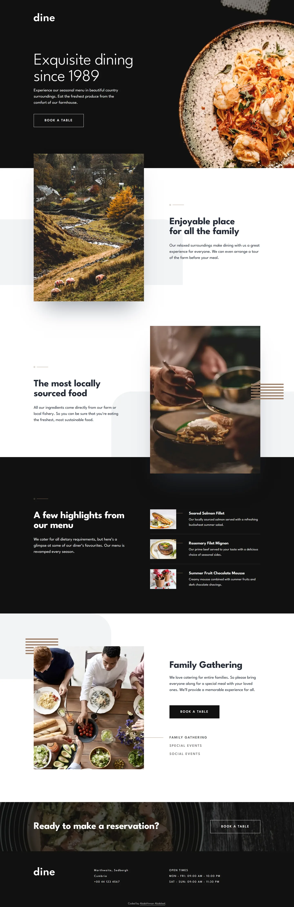

# Dine restaurant website

My solution to the [Dine restaurant website](https://www.frontendmentor.io/challenges/dine-restaurant-website-yAt7Vvxt7)
challenge on Frontend Mentor.

- Live: https://dine-restaurant-website.abdelrhman-ahmed8881.workers.dev
- Code: https://github.com/MrBlackvanta/dine-restaurant-website

## Built with

- Next.js 16, App Router, static export
- React 19 and TypeScript
- Tailwind CSS v4

## Notes

The guest stepper uses `aria-disabled` rather than `disabled` at its bounds. Chrome moves
focus to `<body>` the moment the focused element becomes disabled, so a keyboard user
stepping down to the minimum loses their place and has to tab back from the top of the
page. Keeping the button focusable and guarding the handler avoids that.

Images are art-directed per breakpoint through a small `<picture>` wrapper rather than
`next/image`, since this is a static export and the crops change.

## Author

- [LinkedIn](https://www.linkedin.com/in/abdelrhman-vanta/)
- [UpWork](https://www.upwork.com/freelancers/mrblackvanta)
- [Frontend Mentor](https://www.frontendmentor.io/profile/MrBlackvanta)
